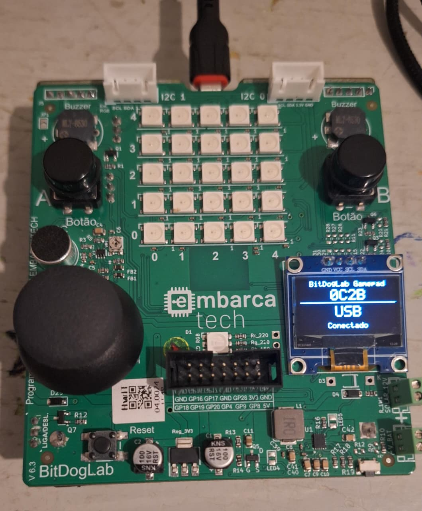
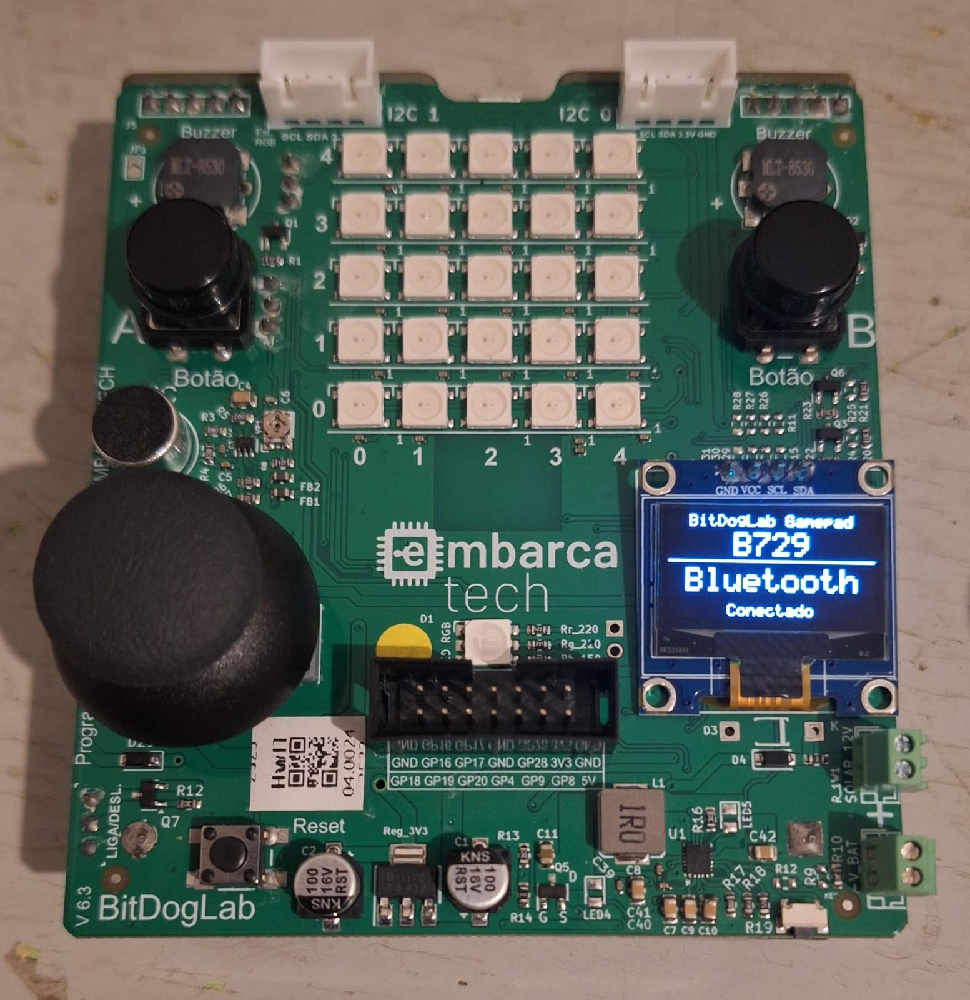
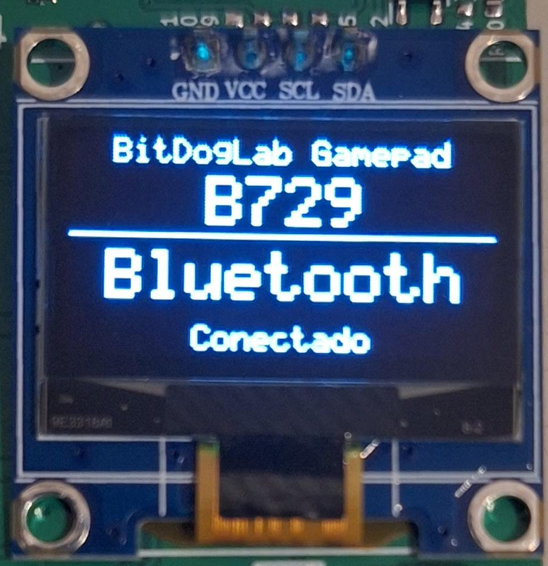
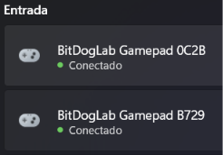
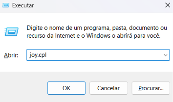
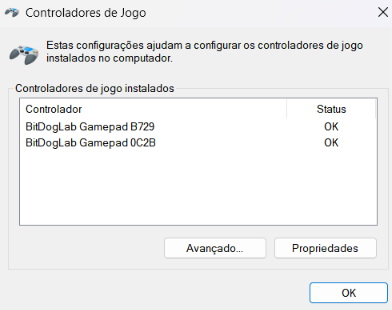
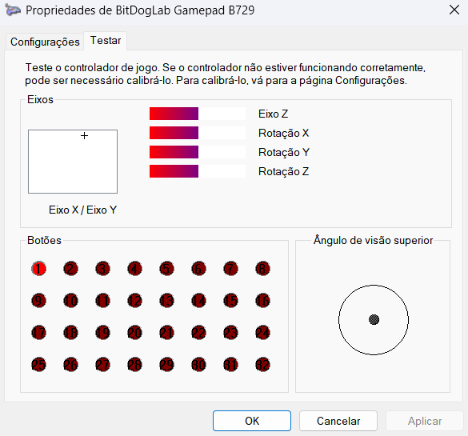
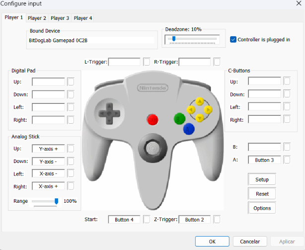

# BitDogLab Gamepad

Transforma a placa **BitDogLab** (Raspberry Pi Pico W) em um **gamepad** genérico, que funciona **pelo cabo USB ou por Bluetooth**. O Windows reconhece a placa como um controle de jogo, sem precisar de driver.

O mapeamento dos botões foi pensado para jogar **Mario Kart 64** no emulador **Project64**, mas o controle funciona em qualquer jogo ou emulador que aceite gamepads USB (DirectInput).

<table>
  <tr>
    <td align="center"></td>
    <td align="center"></td>
  </tr>
  <tr>
    <td align="center">Placa <b>0C2B</b> conectada pelo cabo USB</td>
    <td align="center">Placa <b>B729</b> conectada por Bluetooth</td>
  </tr>
</table>

## Funcionalidades

- Dispositivo USB HID (gamepad) implementado com [TinyUSB](https://github.com/hathach/tinyusb)
- Gamepad Bluetooth Low Energy (HID over GATT) implementado com [BTstack](https://github.com/bluekitchen/btstack)
- Troca automática: com o cabo ligado a um PC usa o USB e desliga o Bluetooth; sem o cabo, usa o Bluetooth
- Display OLED mostrando a identificação da placa, o modo (USB ou Bluetooth) e se há um PC conectado
- Joystick analógico com calibração automática do centro, zona morta e reescala para usar o curso completo do eixo
- Joystick para frente/trás também gera botões digitais (ex.: freio), com histerese contra acionamentos falsos
- Estado verificado a cada 1 ms e enviado ao PC apenas quando muda (polling USB de 1 ms)
- Nome, PID e número de série únicos por placa (ex.: `BitDogLab Gamepad 3F2A` com PID `3F2A`), permitindo usar **várias placas no mesmo PC** sem confusão

## Hardware

Usa apenas componentes que já vêm na BitDogLab:

| Componente         | GPIO | Observação                         |
| ------------------ | ---- | ---------------------------------- |
| Joystick – eixo X  | 27   | ADC canal 1                        |
| Joystick – eixo Y  | 26   | ADC canal 0                        |
| Botão do joystick  | 22   | Pull-up interno, ativo em nível baixo |
| Botão A            | 5    | Pull-up interno, ativo em nível baixo |
| Botão B            | 6    | Pull-up interno, ativo em nível baixo |
| Display OLED SSD1306 128x64 | 14 (SDA), 15 (SCL) | I2C1, endereço 0x3C |

## Mapeamento dos controles

| Ação na BitDogLab         | Nome no Project64 | Nome no Windows (`joy.cpl`) | Botão no N64    | Mario Kart 64               |
| ------------------------- | ----------------- | --------------------------- | --------------- | --------------------------- |
| Joystick esquerda/direita | X-axis            | Eixo X                      | Analógico       | Virar                       |
| Joystick cima/baixo       | Y-axis            | Eixo Y                      | Analógico       | (ex.: jogar item para trás) |
| Botão A                   | Button 3          | Botão 4                     | A               | Acelerar                    |
| Botão B                   | Button 2          | Botão 3                     | Z               | Usar item                   |
| Clique do joystick        | Button 4          | Botão 5                     | Start           | Pausar                      |
| Joystick para trás        | Button 1          | Botão 2                     | B (sugestão)    | Frear / ré                  |
| Joystick para frente      | Button 0          | Botão 1                     | Livre (ex.: R)  | Pular / derrapar            |

> O Project64 numera os botões a partir de 0 e o Windows a partir de 1, por isso os nomes diferem.

> "Joystick para frente/trás" é acionado quando o joystick passa de `LIMIAR_PEDAL` (600 unidades do ADC) a partir do centro, e só é solto quando volta para menos de `LIMIAR_PEDAL_SOLTAR` (450).

> **Importante:** ao ligar, a placa mede a posição de repouso do joystick para usar como centro. Não toque no joystick enquanto liga a placa.

## Display

<p align="center">
  
</p>

O que cada linha significa:

```
   BitDogLab Gamepad
        B729            <- ID da placa (mesmo final do nome no Windows)
 ---------------------
      Bluetooth         <- modo em uso: USB ou Bluetooth
      Conectado         <- Conectado ou Desconectado
```

Ao ligar, aparece "Iniciando... Nao mexa no joystick" enquanto o centro do joystick é calibrado. O ID ajuda a saber qual placa é qual quando há mais de uma ligada no mesmo PC.

O display só é redesenhado quando algo muda, porque cada atualização leva cerca de 25 ms.

## Cabo USB e Bluetooth

A placa escolhe sozinha o meio de comunicação:

| Situação                                       | Meio usado                                   |
| ---------------------------------------------- | -------------------------------------------- |
| Cabo ligado a um PC                            | USB (Bluetooth desligado)                    |
| Sem cabo (alimentada pela bateria)             | Bluetooth                                    |
| Cabo ligado a um carregador (sem PC)           | Bluetooth, após 3 s esperando o PC reconhecer |

A troca acontece com a placa ligada: ao conectar o cabo no PC, o Bluetooth desconecta e o controle passa para o USB; ao desconectar, o Bluetooth volta a anunciar e o PC pareado reconecta sozinho.

### Pareando por Bluetooth

1. Ligue a placa sem o cabo USB (pela bateria).
2. No Windows, abra **Configurações > Bluetooth e dispositivos > Adicionar dispositivo > Bluetooth**.
3. Escolha **BitDogLab Gamepad XXXX** na lista.

Depois de pareado, o controle aparece em **Bluetooth e dispositivos**, na seção **Entrada**. Na imagem, as duas placas estão conectadas ao mesmo tempo:

<p align="center">
  
</p>

O pareamento fica salvo na flash da placa, então só precisa ser feito uma vez por PC. Depois disso, basta ligar a placa sem cabo que o PC reconecta. O controle aparece no `joy.cpl` e no Project64 com o mesmo nome do modo cabo, mas o Windows o trata como outro dispositivo, então é preciso selecioná-lo e mapear os botões novamente no Project64.

> Se gravar o firmware de novo e o PC não reconectar, remova o dispositivo nas configurações de Bluetooth do Windows e pareie outra vez.

## Resultados nos testes

Testei o controle jogando Mario Kart 64 no Project64, com duas placas ao mesmo tempo (uma pelo cabo e outra por Bluetooth). O resultado foi muito bom:

- **Direção precisa e sem atraso perceptível:** o kart responde ao joystick na hora, tanto no cabo quanto no Bluetooth.
- **Primeiro pareamento fácil:** basta adicionar o dispositivo nas configurações de Bluetooth do Windows.
- **Reconexão automática e rápida:** depois do primeiro pareamento, a placa reconecta sozinha em poucos instantes ao ser ligada.

Gostei muito do resultado.

## Como compilar

### Pré-requisitos

- [VS Code](https://code.visualstudio.com/) com a extensão **Raspberry Pi Pico**
- Pico SDK **1.5.1** e toolchain ARM **13_2_Rel1** (instalados automaticamente pela extensão)

### Pela extensão do VS Code

1. Abra a pasta do projeto no VS Code.
2. Importe o projeto pela extensão Raspberry Pi Pico, se solicitado.
3. Clique em **Compile Project**.
4. O firmware será gerado em `build/BitDogLabGamepad.uf2`.

### Pela linha de comando

```bash
mkdir build
cd build
cmake .. -G Ninja
ninja
```

## Como gravar na placa

1. Desconecte a BitDogLab do USB.
2. Segure o botão **BOOTSEL** do Pico W e conecte o cabo USB.
3. A placa aparecerá como um pendrive (`RPI-RP2`).
4. Copie o arquivo `BitDogLabGamepad.uf2` para essa unidade.

A placa reinicia sozinha e passa a funcionar como gamepad.

> Alternativa: use **Run Project** na extensão do VS Code ou `picotool load -x build/BitDogLabGamepad.uf2 -f`.

## Testando no Windows

1. Pressione `Win + R`, digite `joy.cpl` e pressione Enter.

   

2. O dispositivo **BitDogLab Gamepad XXXX** deve aparecer na lista (`XXXX` são os 4 últimos dígitos do ID da placa). Cada placa aparece com seu próprio nome:

   

3. Selecione o controle e clique em **Propriedades**. Na aba **Testar**, a cruz acompanha o joystick e os botões acendem ao serem acionados. Na imagem, o joystick está empurrado para frente, o que move a cruz para cima e aciona o Botão 1:

   

## Configurando no Project64

1. Abra o Project64 e vá em **Options > Configure Controller Plugin**.
2. Selecione o controle **BitDogLab Gamepad XXXX** em **Bound Device** do Player 1 e marque **Controller is plugged in**.
3. Clique em cada botão do N64 e acione o comando correspondente na placa, seguindo a tabela de [mapeamento](#mapeamento-dos-controles).
4. Para multiplayer, conecte uma segunda placa e configure-a no Player 2 — o sufixo do nome identifica cada uma.

Exemplo de configuração do Player 1:

<p align="center">
  
</p>

| Campo no Project64 | Valor        |
| ------------------ | ------------ |
| Analog Stick Up    | Y-axis +     |
| Analog Stick Down  | Y-axis -     |
| Analog Stick Left  | X-axis -     |
| Analog Stick Right | X-axis +     |
| A                  | Button 3     |
| Z-Trigger          | Button 2     |
| Start              | Button 4     |
| B (opcional)       | Button 1     |
| R-Trigger (opcional) | Button 0   |

> **Deadzone:** o firmware já ignora pequenos movimentos em torno do centro (`ZONA_MORTA`), então a zona morta do Project64 pode ficar baixa, em torno de **10%**. Valores altos deixam as curvas menos precisas.
>
> A conexão por cabo e a por Bluetooth aparecem como dispositivos diferentes, então cada uma precisa da sua própria configuração.

## Estrutura do projeto

```
BitDogLabGamepad/
├── src/
│   ├── main.c                      # Laço principal: escolhe USB ou Bluetooth, envia o estado e atualiza o display
│   ├── controle/
│   │   └── controle.c/.h           # Leitura do joystick e dos botões e montagem do relatório HID
│   ├── identificacao/
│   │   └── identificacao.c/.h      # Nome, número de série, ID e PID da placa (a partir do ID do chip)
│   ├── usb/
│   │   ├── usb_descriptors.c/.h    # Descritores USB (dispositivo, HID, configuração e strings)
│   │   └── tusb_config.h           # Configuração do TinyUSB (apenas classe HID, modo device)
│   ├── bluetooth/
│   │   ├── bluetooth_gamepad.c/.h  # Gamepad Bluetooth (BLE, HID over GATT) com o BTstack
│   │   ├── gamepad_ble.gatt        # Serviços BLE (convertido em gamepad_ble.h na compilação)
│   │   └── btstack_config.h        # Configuração do BTstack
│   └── tela/
│       └── tela.c/.h               # Driver do display OLED SSD1306 (I2C) com fonte 5x7
├── docs/
│   └── imagens/                    # Fotos e capturas de tela usadas neste README
├── .vscode/                        # Configuração da extensão Raspberry Pi Pico
├── CMakeLists.txt                  # Configuração de build do Pico SDK
├── pico_sdk_import.cmake           # Importação do Pico SDK
├── LICENSE                         # Licença MIT
└── README.md
```

O `main.c` só coordena os módulos; cada pasta cuida de uma parte do hardware ou da comunicação.

## Ajustes

Leitura do joystick, em [src/controle/controle.c](src/controle/controle.c):

| Constante                | Padrão | Descrição                                                   |
| ------------------------ | ------ | ----------------------------------------------------------- |
| `ZONA_MORTA`             | 200    | Desvio do centro ignorado, evita drift do joystick          |
| `LIMIAR_PEDAL`           | 600    | Quanto empurrar o joystick para acionar os botões de frente/trás |
| `LIMIAR_PEDAL_SOLTAR`    | 450    | Abaixo disso esses botões soltam (histerese)                |
| `AMOSTRAS_CALIBRACAO`    | 32     | Leituras usadas para medir o centro do joystick ao ligar    |

Comunicação, em [src/main.c](src/main.c):

| Constante                     | Padrão | Descrição                                                   |
| ----------------------------- | ------ | ----------------------------------------------------------- |
| `INTERVALO_RELATORIO_MS`      | 1      | Intervalo entre verificações do estado (envia só se mudou)  |
| `INTERVALO_VERIFICAR_CABO_MS` | 100    | Intervalo entre verificações do cabo e do display           |
| `TEMPO_ESPERA_USB_MS`         | 3000   | Tempo esperando o PC reconhecer a placa antes de usar o Bluetooth |

Para mudar o mapeamento de botões, edite a função `ler_botoes()` em [src/controle/controle.c](src/controle/controle.c).

## Observações

- O TinyUSB e o BTstack definem tipos com o mesmo nome, por isso o código de cada um fica em arquivos separados. Os cabeçalhos compartilhados (`identificacao.h`, `usb_descriptors.h`, `bluetooth_gamepad.h`) não incluem nenhum dos dois.
- No Bluetooth, o PC define o intervalo de conexão (o firmware pede de 7,5 a 15 ms), então a resposta pode ser um pouco mais lenta que no cabo (1 ms).
- A porta USB é usada exclusivamente como gamepad, por isso o `stdio` via USB está desativado (`printf` não aparece no monitor serial).
- O VID `0xCafe` é o de teste usado nos exemplos do TinyUSB, adequado para uso pessoal e educacional.
- O PID de cada placa vem dos 4 últimos dígitos do ID único do chip. Isso é necessário porque o Windows guarda o nome do controle pelo par VID/PID (em `HKCU\System\CurrentControlSet\Control\MediaProperties\PrivateProperties\Joystick\OEM`); com um PID fixo, todas as placas apareceriam com o nome da primeira conectada.

## Licença

O código deste projeto está sob a [licença MIT](LICENSE): pode ser usado, modificado e redistribuído, inclusive em outros projetos, desde que o aviso de autoria seja mantido.

### Bibliotecas de terceiros

O firmware é compilado junto com bibliotecas do Pico SDK, que têm licenças próprias e **não** são cobertas pela licença MIT deste repositório:

- **[BTstack](https://github.com/bluekitchen/btstack)** (BlueKitchen GmbH), usado no modo Bluetooth. A licença do BTstack permite uso, modificação e redistribuição apenas **para fins pessoais e não comerciais**; uso comercial exige licença da BlueKitchen. A Raspberry Pi informa ter um acordo com a BlueKitchen que cobre o uso do BTstack no Pico W. Antes de qualquer uso comercial, consulte os termos da Raspberry Pi e da BlueKitchen.
- **[cyw43-driver](https://github.com/georgerobotics/cyw43-driver)**, driver do chip sem fio do Pico W, licenciado para uso com placas Raspberry Pi.
- **[TinyUSB](https://github.com/hathach/tinyusb)** e o restante do **[Pico SDK](https://github.com/raspberrypi/pico-sdk)**, sob licenças MIT e BSD-3-Clause.

Essas bibliotecas não estão neste repositório; elas vêm do Pico SDK instalado na máquina. Quem distribuir o firmware compilado (`.uf2`) deve incluir os avisos de licença delas.
